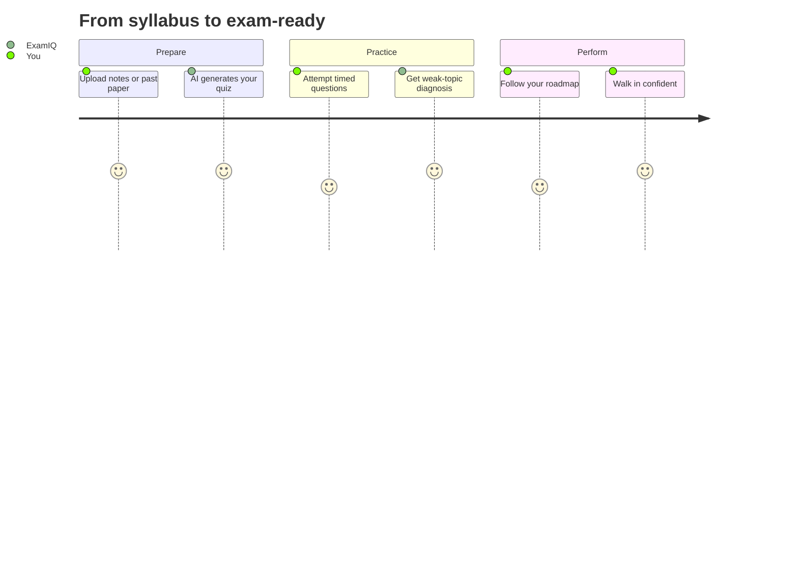
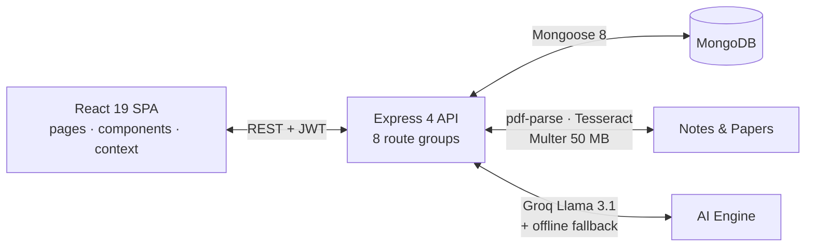

<div align="center">


# ExamIQ

### Your AI Exam Coach — *Prepare Smarter. Achieve More.*

Turn PDFs into practice quizzes · Decode past papers · Chat with an AI tutor ·
Find your weak topics before the examiner does.

[](https://github.com/Patelprince6064/ExamIQ/stargazers)
[](https://github.com/Patelprince6064/ExamIQ/network/members)
[](https://github.com/Patelprince6064/ExamIQ/issues)
[](https://opensource.org/licenses/MIT)

[](https://react.dev/)
[](https://nodejs.org/)
[](https://www.mongodb.com/)
[](https://expressjs.com/)

[Features](#-what-examiq-does) · [Live Tour](#-the-30-second-tour) · [Quickstart](#-quickstart) · [API](#-api-reference) · [Architecture](#-how-it-works) · [Roadmap](#-roadmap)

</div>

---

## 🎯 The problem with studying

Students drown in PDFs, reread the same notes five times, and discover their weak
topics **in the exam hall**. ExamIQ flips that: upload what you have, practice like
it's exam day, and let AI show you exactly what to fix — while there's still time.

## ✨ What ExamIQ does

| | Capability | How it helps you |
|---|---|---|
| 🤖 | **AI Exam Tutor** | CS-specialized chat (DSA, OS, DBMS, CN, SE) with clean, exam-ready explanations — no markdown clutter |
| 📄 | **Notes → Quiz** | Upload notes/slides/textbooks (**up to 50 MB**: PDF, PNG, JPG, WebP) and get MCQs with explanations + difficulty tiers |
| 📑 | **Paper Analyzer** | Extracts high-frequency topics from past papers and generates model answers with scoring points |
| 🧠 | **Weak-Topic Intelligence** | Replaces bare percentages with diagnostics — *Round Robin Scheduling, B+ Trees, Normalization…* — plus what to revise |
| 🗺️ | **Study Roadmaps** | Timelines from today to exam day, built around your priorities |
| 📊 | **Analytics Dashboard** | Accuracy, mastery and streaks via Chart.js + Recharts |
| ⏱️ | **Focus Timer** | Floating Pomodoro widget that survives page navigation |
| 🛡️ | **Offline Fallback Engine** | Built-in academic knowledge base keeps the app useful even with zero AI credits |

## ⚡ The 30-second tour



1. **Land** on a cinematic home page — interactive dotted globe, blur-to-sharp
   headline reveals, student-stories marquee.
2. **Upload** a PDF in *PDF Upload* (or a past paper in *Paper Analyzer*).
3. **Practice** in *AI Practice* — MCQs, descriptive answers, instant feedback.
4. **Diagnose** in *Analytics* — see the 3 topics costing you marks.
5. **Execute** your *Roadmap* — day-by-day plan to exam day.

---

## 🧱 Tech stack

| Layer | Choices |
|---|---|
| **Frontend** | React 19 · React Router v7 · Vanilla CSS (glassmorphism, responsive) · Chart.js + Recharts · `cobe` WebGL globe · `react-icons` |
| **Backend** | Node.js 18+ · Express 4 · Mongoose 8 · JWT + bcryptjs · Multer (50 MB) · `pdf-parse` + Tesseract OCR |
| **AI** | Groq `llama-3.1-8b-instant` with an **offline academic fallback engine** (works without API keys) |
| **Hardening** | Helmet headers · CORS · express-rate-limit (global + stricter AI limits) · Morgan logging |
| **Deploy** | Vercel (frontend) + Render/serverless (backend) — see [DEPLOYMENT.md](DEPLOYMENT.md) |

## 🏗️ How it works



### 📂 Project structure

```
ExamIQ/
├── frontend/                      # React 19 SPA (proxy → localhost:5000)
│   ├── public/                    # index.html, favicon, _redirects
│   └── src/
│       ├── App.js / index.js      # Router (v7) + entry point
│       ├── assets/                # logo, hero art (only what's used)
│       ├── pages/                 # One file + CSS per screen:
│       │                         # Home, Dashboard, AIPractice, Subjects,
│       │                         # Analytics, Settings, PdfUpload,
│       │                         # PaperAnalyzer, Roadmap, Login, Register
│       ├── components/
│       │   ├── landing/           # DottedGlobe, TextReveal, Marquee
│       │   ├── layout/            # SharedSidebar shell
│       │   └── timer/             # Floating focus timer
│       ├── context/               # TimerContext (global timer state)
│       ├── services/              # api.js — single API client (auth + calls)
│       └── *.css                  # App + global styles
├── backend/                       # Express API (port 5000)
│   ├── server.js                  # App entry (also serverless-safe export)
│   ├── api/index.js               # Serverless wrapper (Vercel)
│   ├── config/                    # db.js, aiFallback.js (offline brain)
│   ├── middleware/                # auth.js (JWT), upload.js (Multer 50MB)
│   ├── models/                    # User, Note, QuizResult
│   ├── routes/                    # auth, chat, quiz, paper, subjects,
│   │                              # analytics, progress, user
│   └── .env.example               # Copy to .env to configure
├── DEPLOYMENT.md / SETUP.md       # Render + Vercel guides
├── start-all.bat                  # One-click Windows launcher
└── README.md                      # You are here 👋
```

---

## 🚀 Quickstart

### Prerequisites

- [Node.js](https://nodejs.org/) **18+** · npm · [Git](https://git-scm.com/)
- [MongoDB](https://www.mongodb.com/try/download/community) locally (`27017`)
  **or** a free [MongoDB Atlas](https://www.mongodb.com/cloud/atlas) connection string

### 1️⃣ Clone

```bash
git clone https://github.com/Patelprince6064/ExamIQ.git
cd ExamIQ
```

### 2️⃣ Backend

```bash
cd backend
npm install
cp .env.example .env   # Windows: copy .env.example .env
```

| Variable | Required | What it does |
|---|---|---|
| `PORT` | No (default `5000`) | API port |
| `MONGO_URI` | ✅ | `mongodb://localhost:27017/ai-exam-prep` or Atlas SRV string |
| `JWT_SECRET` | ✅ | Long random string for signing tokens |
| `JWT_EXPIRES_IN` | No (default `7d`) | Token lifetime |
| `CLIENT_URL` | No | Frontend origin (`http://localhost:3000`) |
| `GROQ_API_KEY` | No | Enables live Llama 3.1; **offline engine covers you without it** |

### 3️⃣ Frontend

```bash
cd ../frontend
npm install
```

### 4️⃣ Run

| Terminal 1 — API | Terminal 2 — App |
|---|---|
| `cd backend && npm start` → `http://localhost:5000` | `cd frontend && npm start` → `http://localhost:3000` |

> 🪟 **Windows shortcut:** double-click `start-all.bat` (starts MongoDB service + both servers).

### ✅ Smoke test

1. Open `http://localhost:3000` → landing page loads with the globe hero.
2. Register → log in → dashboard greets you by name.
3. *AI Practice* → generate a quiz (works **without** `GROQ_API_KEY` via fallback).
4. `http://localhost:5000` returns `{ status: "✅ AI Exam Prep Backend Running" }`.

---

## 📡 API reference

Base URL `http://localhost:5000`. Send `Authorization: Bearer <JWT>` where marked ✅.

### 🔐 Auth — `/api/auth`

| Method | Endpoint | Auth | Description |
|---|---|---|---|
| `POST` | `/api/auth/register` | ❌ | Create account, receive JWT |
| `POST` | `/api/auth/login` | ❌ | Log in, receive JWT |
| `GET` | `/api/auth/me` | ✅ | Current user profile |

### 🤖 AI Tutor — `/api/chat` (also `/chat`)

| Method | Endpoint | Auth | Description |
|---|---|---|---|
| `POST` | `/api/chat` | ✅ | Ask anything academic, get structured explanations |

### 📝 Notes & quizzes — `/api/user`

| Method | Endpoint | Auth | Description |
|---|---|---|---|
| `POST` | `/api/user/upload-note` | ✅ | Upload notes/textbook (≤ 50 MB) |
| `GET` | `/api/user/notes` | ✅ | List your notes |
| `POST` | `/api/user/notes/:id/generate-quiz` | ✅ | Quiz straight from *your* material |
| `DELETE` | `/api/user/notes/:id` | ✅ | Delete a note |

### 🧠 Quiz engine — `/api/quiz`

| Method | Endpoint | Auth | Description |
|---|---|---|---|
| `POST` | `/api/quiz/generate` | ✅ | MCQs by subject + difficulty |
| `POST` | `/api/quiz/descriptive` | ✅ | University-style descriptive questions |
| `POST` | `/api/quiz/submit` | ✅ | Submit → weak-topic diagnosis |
| `GET` | `/api/quiz/history` | ✅ | Past attempts & scores |

### 📑 Papers — `/api/paper` · 📚 Subjects — `/api/subjects`

| Method | Endpoint | Auth | Description |
|---|---|---|---|
| `POST` | `/api/paper/analyze` | ✅ | Topic-frequency extraction or full model solutions |
| `*` | `/api/subjects/...` | ✅ | Subject library & topic management (see [`backend/routes/subjects.js`](backend/routes/subjects.js)) |

### 📊 Analytics — `/api/analytics` · 📈 Progress — `/api/progress`

| Method | Endpoint | Auth | Description |
|---|---|---|---|
| `*` | `/api/analytics/...` | ✅ | Accuracy, mastery, streaks (see [`backend/routes/analytics.js`](backend/routes/analytics.js)) |
| `*` | `/api/progress/...` | ✅ | Roadmaps & study-progress tracking (see [`backend/routes/progress.js`](backend/routes/progress.js)) |

> ⏳ **Rate limits:** 100 req / 15 min globally · 20 AI req / min on `/chat` + `/api/quiz`.

---

## ❓ FAQ

**Do I need a Groq API key?**
No. The offline fallback engine generates quizzes, explanations and plans out of the
box. Add `GROQ_API_KEY` when you want live Llama 3.1 quality.

**Where is my data stored?**
Your own MongoDB (local or Atlas). Uploads live in `backend/uploads/` (git-ignored);
PDF text is extracted server-side — nothing is sent anywhere except the AI provider
you configure.

**Why is the landing page so light?**
Images were cut, `backdrop-blur` dropped, scroll handling is rAF-throttled and
offscreen sections use `content-visibility` — it stays at 60 fps on mid-range phones.

**How do I deploy?**
Follow [DEPLOYMENT.md](DEPLOYMENT.md): backend on Render, frontend on Vercel,
database on Atlas. `frontend/vercel.json` + `backend/vercel.json` rewrites are
already wired.

---

## 🗺️ Roadmap

- [ ] Spaced-repetition flashcards from weak topics
- [ ] Timed mock-exam mode with negative marking
- [ ] Leaderboards & study groups
- [ ] PWA offline mode + mobile apps
- [ ] Multi-language explanations

Ideas welcome — open an [issue](https://github.com/Patelprince6064/ExamIQ/issues)!

## 🤝 Contributing

```bash
git checkout -b feat/my-idea
# frontend/src/pages/* for screens, components/* for reusable UI,
# backend/routes/* for endpoints — then open a PR
```

Small, focused PRs with a before/after note get reviewed fastest. ⭐

## 👨‍💻 Author

**Prince Patel** — passionate about EdTech, AI engineering and full-stack craft.

- GitHub: [@Patelprince6064](https://github.com/Patelprince6064)
- Repo: [Patelprince6064/ExamIQ](https://github.com/Patelprince6064/ExamIQ)
- Email: `pp50646464@gmail.com`

## 📄 License

MIT — free to use, fork and build upon. If ExamIQ helps you ace an exam,
a ⭐ is the cheapest tuition you'll ever pay. Good luck! 🎓
